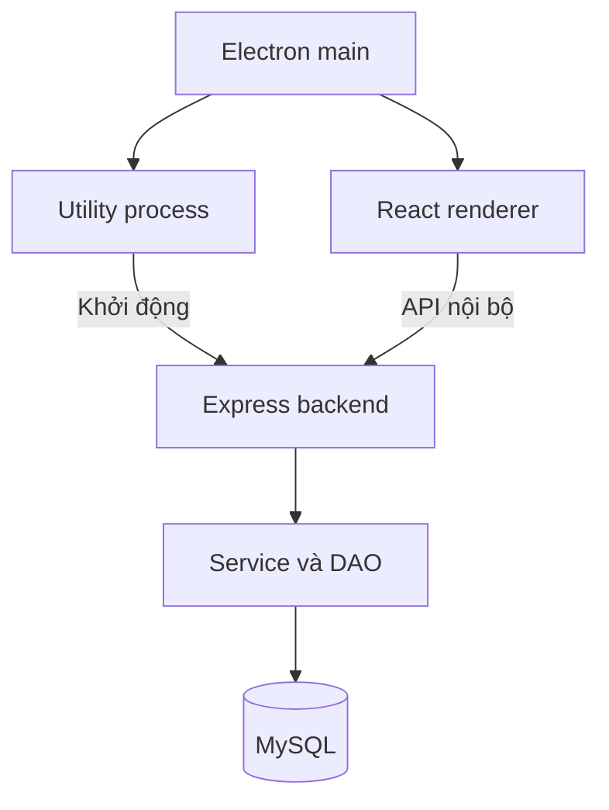

# Vận Hành

Ứng dụng desktop quản lý hãng vận tải hành khách đường dài, được xây dựng cho **Project 5 môn Cơ sở dữ liệu**. Hệ thống quản lý xe khách, tài xế, tuyến đường và chuyến xe; từ dữ liệu đó tính lương, tổng hợp doanh thu và theo dõi hạn bảo dưỡng.

| Thông tin | Nội dung |
| --- | --- |
| Phiên bản được mô tả | 1.3.5 |
| Nền tảng bản đóng gói | Windows x64 |
| Cơ sở dữ liệu | MySQL |
| Giao diện | Tiếng Việt, hỗ trợ sáng và tối |
| Người thực hiện | Lê Nam |

## Mục lục

- [Chức năng](#chức-năng)
- [Công nghệ](#công-nghệ)
- [Kiến trúc và mã nguồn](#kiến-trúc-và-mã-nguồn)
- [Chạy bản Windows](#chạy-bản-windows)
- [Chạy từ mã nguồn](#chạy-từ-mã-nguồn)
- [Cơ sở dữ liệu](#cơ-sở-dữ-liệu)
- [Quy tắc nghiệp vụ](#quy-tắc-nghiệp-vụ)
- [Vai trò và phân quyền](#vai-trò-và-phân-quyền)
- [Đăng ký chuyến của hành khách](#đăng-ký-chuyến-của-hành-khách)
- [Nhập xuất và sao lưu](#nhập-xuất-và-sao-lưu)
- [Kiểm thử và đóng gói](#kiểm-thử-và-đóng-gói)
- [Xử lý lỗi thường gặp](#xử-lý-lỗi-thường-gặp)
- [Giới hạn và hướng phát triển](#giới-hạn-và-hướng-phát-triển)
- [Tài liệu trong dự án](#tài-liệu-trong-dự-án)

## Chức năng

### Quản lý vận tải

- **Xe khách:** thêm, sửa, tra cứu thông số xe, sức chứa, lịch sử chuyến và mốc bảo dưỡng.
- **Tài xế:** quản lý hồ sơ, bằng lái, thâm niên, lương tháng và lịch sử tham gia chuyến.
- **Tuyến đường:** quản lý điểm đầu, điểm cuối, độ dài và độ phức tạp cấp 1, 2, 3.
- **Chuyến xe:** lập chuyến, chọn xe, tuyến, ngày đi, lái chính, phụ xe, số khách và giá vé.
- Tìm kiếm, lọc, phân trang, xem chi tiết và nhân bản chuyến.
- Xem lịch trình theo ngày hoặc tuần; gợi ý xe đủ sức chứa.

### Báo cáo theo yêu cầu Project 5

| Báo cáo | Kết quả |
| --- | --- |
| Lương tài xế | Tên tài xế, số lượt theo hai vai trò và lương từ đầu tháng đến hôm nay |
| Doanh thu theo xe | Số chuyến, tổng khách và doanh thu trong khoảng ngày được chọn |
| Bảo dưỡng | Km làm việc, ngày bảo dưỡng tiếp theo và danh sách xe quá hạn |
| Số bản ghi | Số dòng từng bảng và tổng số dòng của bốn bảng nghiệp vụ |

### Tiện ích mở rộng

- Dashboard tổng quan, phân tích khách theo tuyến, tỷ lệ sử dụng chỗ và xe lâu không hoạt động.
- Tài khoản, đăng nhập, ba vai trò và nhật ký thao tác.
- Cổng hành khách để tìm chuyến, đăng ký số chỗ và hủy đăng ký trước ngày đi.
- Nhập Excel hoặc CSV; xuất bảng và báo cáo; in hoặc lưu PDF qua tiện ích desktop.
- Sao lưu và phục hồi dữ liệu nghiệp vụ bằng JSON.
- Tạo và đọc QR để tra cứu chuyến.
- Bản đồ hai đầu tuyến với Leaflet và OpenStreetMap.

## Công nghệ

| Thành phần | Công nghệ |
| --- | --- |
| Giao diện | React, JSX |
| Định dạng và biểu tượng | Tailwind CSS, Lucide React |
| Ứng dụng desktop | Electron |
| Backend | Node.js, Express |
| CSDL và kết nối | MySQL, mysql2 |
| Kiểm tra đầu vào | Zod |
| Bảo mật tài khoản | bcryptjs, Node.js crypto |
| Nhập xuất dữ liệu | ExcelJS, csv-parse |
| QR | qrcode, jsQR |
| Bản đồ | Leaflet, OpenStreetMap |
| Build và đóng gói | Vite, electron-builder |

Ngôn ngữ chính là JavaScript, SQL, HTML và CSS. JSX được dùng để mô tả giao diện React. Các tệp `.mjs` và `.cjs` đều là JavaScript.

## Kiến trúc và mã nguồn



Electron tạo cửa sổ ứng dụng riêng. Backend chạy trong tiến trình dữ liệu và chỉ lắng nghe tại `127.0.0.1`, với cổng được chọn khi khởi động. Người dùng bản đóng gói mở ứng dụng trực tiếp; MySQL Server chạy như một dịch vụ riêng.

Controller nhận yêu cầu từ giao diện. Service kiểm tra quyền và nghiệp vụ, tổ chức giao dịch. DAO thực hiện SQL qua `mysql2`, còn MySQL kiểm tra các ràng buộc lưu trữ.

Các đường dẫn dưới đây tính từ thư mục mã nguồn chứa `package.json`:

| Đường dẫn | Nội dung |
| --- | --- |
| `client/src/pages/` | Các màn hình quản lý, báo cáo và cổng hành khách |
| `client/src/components/` | Bảng, biểu mẫu, dialog và thành phần dùng chung |
| `client/src/lib/api.js` | Gọi API từ giao diện |
| `server/controllers/` | Tiếp nhận yêu cầu và trả phản hồi |
| `server/services/` | Quy tắc nghiệp vụ, báo cáo, đăng ký chỗ, tệp và bản đồ |
| `server/dao/` | Truy vấn và cập nhật CSDL |
| `server/middleware/auth.js` | Phiên đăng nhập, CSRF và phân quyền |
| `desktop/main.mjs` | Cửa sổ, menu, cấu hình và vòng đời desktop |
| `desktop/preload.cjs` | Cầu nối các thao tác desktop được cho phép |
| `desktop/backend-service.cjs` | Khởi động và dừng backend nội bộ |
| `database/01_project5.sql` | Schema, ràng buộc, dữ liệu mẫu và truy vấn nghiệp vụ |
| `database/02_app.sql` | Các bảng và ràng buộc bổ sung của ứng dụng |

## Chạy bản Windows

### Điều kiện

- Windows x64.
- MySQL Server **8.0.16 trở lên**, đang chạy và truy cập được.
- Tài khoản MySQL có quyền phù hợp với CSDL. Khi khởi tạo hoặc nâng cấp, cần quyền tạo hoặc sửa bảng, view, trigger và procedure.

Bản đóng gói đã kèm Electron và bộ chạy Node.js. Người dùng bản này không cần chạy `npm install` hoặc cài Python để mở ứng dụng.

### Các bước mở lần đầu

1. Giải nén toàn bộ gói, giữ nguyên `resources`, `locales`, các DLL và tệp đi kèm.
2. Bật dịch vụ MySQL Server.
3. Mở `VanHanh_Desktop/VanHanh.exe`.
4. Nhập thông tin kết nối MySQL.
5. Chọn **Kiểm tra kết nối**; khởi tạo hoặc nâng cấp CSDL nếu cần.
6. Chọn **Lưu và mở ứng dụng**.
7. Nếu hệ thống chưa có tài khoản Vận Hành, tạo quản trị viên đầu tiên trên màn hình thiết lập.
8. Kiểm tra dữ liệu xe, tài xế, tuyến và chuyến trước khi mở báo cáo.

| Trường kết nối | Giá trị thông dụng khi MySQL cùng máy |
| --- | --- |
| Máy chủ | `127.0.0.1` |
| Cổng | `3306` |
| CSDL | `Project5_VanTai` |
| Tài khoản và mật khẩu | Dùng thông tin thực tế của MySQL Server |

**Tài khoản MySQL và tài khoản Vận Hành là hai loại khác nhau.** Tài khoản MySQL kết nối máy chủ dữ liệu; tài khoản Vận Hành dùng để đăng nhập và nhận quyền trong ứng dụng.

Các lần sau chỉ cần bật MySQL và mở EXE. Có thể đổi kết nối trong menu **Tệp**. Đóng Vận Hành không xóa dữ liệu và không tắt MySQL Server.

## Chạy từ mã nguồn

### Điều kiện

- Node.js **tối thiểu 22.12.0** theo cấu hình bản dự án được mô tả.
- npm đi kèm Node.js.
- MySQL Server 8.0.16 trở lên.

Mở terminal tại **thư mục chứa `package.json`**; trong gói bàn giao, đây là thư mục `ma-nguon`.

```bash
npm install
npm run build
npm start
```

- `npm install`: cài các gói phụ thuộc.
- `npm run build`: build giao diện production.
- `npm start`: mở ứng dụng Electron.

Lệnh `npm run dev` của dự án cũng build giao diện trước khi mở Electron. Sau khi ứng dụng khởi động, cấu hình MySQL và tạo tài khoản theo quy trình mở lần đầu.

### Chuẩn bị CSDL thủ công

Trong MySQL Workbench, chạy lần lượt hai tệp trong cùng CSDL:

1. `database/01_project5.sql`.
2. `database/02_app.sql`.

Ứng dụng cũng có cơ chế khởi tạo và nâng cấp từ giao diện. Script nghiệp vụ chỉ nạp dữ liệu mẫu khi cả bốn bảng nghiệp vụ đang rỗng.

## Cơ sở dữ liệu

### Bốn bảng nghiệp vụ

| Bảng | Khóa chính | Nội dung |
| --- | --- | --- |
| `XE_KHACH` | `BienSo` | Thông số xe, sức chứa và bảo dưỡng |
| `TAI_XE` | `CMT` | Hồ sơ tài xế và lương tháng hiện tại |
| `TUYEN_DUONG` | `MaTuyen` | Điểm đầu, điểm cuối, độ dài và độ phức tạp |
| `CHUYEN_XE` | `MaSoChuyenXe` | Ngày đi, phân công, số khách, giá vé và doanh thu |

`CHUYEN_XE` có bốn khóa ngoại: `BienSo`, `MaTuyen`, `CMTLaiXe` và `CMTPhuXe`. Hai khóa tài xế cùng tham chiếu `TAI_XE.CMT`, phân biệt vai trò theo từng chuyến.

Mô hình EER có **28 thuộc tính**. Khi chuyển sang bảng, thêm bốn khóa ngoại để triển khai quan hệ, tạo **32 cột nghiệp vụ**.

### Bốn bảng ứng dụng

| Bảng | Nội dung |
| --- | --- |
| `APP_TAI_KHOAN` | Tài khoản, mật khẩu đã băm, vai trò và trạng thái |
| `APP_PHIEN_DANG_NHAP` | Phiên đăng nhập, kiểm tra CSRF và thời hạn |
| `APP_NHAT_KY` | Người thao tác, thời điểm và dữ liệu trước sau |
| `APP_DANG_KY_CHUYEN` | Số chỗ đăng ký, giá xác nhận, trạng thái và lịch sử chuyến |

### Dữ liệu mẫu và làm mới báo cáo

Bộ mẫu ban đầu có **6 xe, 6 tài xế, 6 tuyến, 20 chuyến**, tổng cộng **38 bản ghi nghiệp vụ**. Con số này thay đổi sau khi thêm hoặc xóa dữ liệu. Các bảng `APP_` và view không được cộng vào chỉ tiêu này.

Khi đọc trực tiếp các cột dẫn xuất trong Workbench ở ngày khác, chạy hai thủ tục làm mới trước:

```sql
USE Project5_VanTai;

CALL P5_CapNhatLuongThang();
CALL P5_CapNhatNgayBaoDuong();

SELECT * FROM XE_KHACH;
SELECT * FROM TAI_XE;
SELECT * FROM TUYEN_DUONG;
SELECT * FROM CHUYEN_XE;
```

Một câu `SELECT` không tự kích hoạt trigger. Ứng dụng có tác vụ làm mới các giá trị cần thiết khoảng mỗi 60 giây khi đang hoạt động.

## Quy tắc nghiệp vụ

### Phân công và sức chứa

- Mỗi chuyến có đúng một xe, một tuyến, một lái chính và một phụ xe.
- Lái chính và phụ xe phải là hai người khác nhau.
- Một tài xế có thể đổi vai trò giữa các chuyến.
- Số khách phải thỏa `0 ≤ SoKhach ≤ SoGhe − 2`.
- Độ dài tuyến lớn hơn 0; độ phức tạp thuộc `{1, 2, 3}`; giá vé không âm.

Ví dụ xe 45 ghế chỉ nhận tối đa 43 hành khách. Khi giảm số ghế, hệ thống kiểm tra các chuyến đã lưu để bảo vệ dữ liệu hiện có.

### Lương tài xế

Tiền công mỗi lượt:

```text
Tiền công = 100.000 × hệ số vai trò × hệ số lương tuyến
```

Hệ số vai trò là **2 với lái chính**, **1 với phụ xe**. Lương tháng cộng các lượt từ đầu tháng đến hôm nay.

| Cấp tuyến | Hệ số lương | Hệ số đường khó dùng cho bảo dưỡng |
| --- | --- | --- |
| 1 | 1,00 | 1,00 |
| 2 | 1,20 | 1,30 |
| 3 | 1,50 | 1,60 |

Mức cơ sở và hai bộ hệ số do dự án lựa chọn theo đề. Hệ số lương và hệ số đường khó phục vụ hai phép tính riêng.

### Doanh thu

```text
Doanh thu chuyến = số khách × giá vé của chính chuyến đó
Doanh thu xe = tổng doanh thu các chuyến hợp lệ trong kỳ
```

Khoảng ngày lấy cả hai ngày biên và chỉ cộng chuyến có ngày không sau hôm nay. Xe chưa có chuyến trong kỳ vẫn xuất hiện với doanh thu 0. Báo cáo phản ánh giá trị theo số khách và giá vé; chưa có đối soát tiền thanh toán thực tế.

### Bảo dưỡng

```text
K = tổng (độ dài tuyến × hệ số đường khó)
N = FLOOR(K / 100)
Ngày hạn = ngày bảo dưỡng cuối cùng + (360 − N) ngày
```

Chỉ cộng km từ mốc bảo dưỡng gần nhất đến hôm nay. Cộng toàn bộ km rồi mới làm tròn: hai chuyến 60 km quy đổi tạo 120 km, giảm một ngày.

- Ngày hạn trước hôm nay: **quá hạn**.
- Ngày hạn bằng hôm nay: **đến hạn hôm nay**.
- Ngày hạn sau hôm nay: **chưa đến hạn**.

## Vai trò và phân quyền

| Thao tác | Quản trị viên | Nhân viên | Hành khách |
| --- | --- | --- | --- |
| Dashboard và báo cáo vận hành | Có | Có | Không |
| Xem, thêm, sửa xe, tài xế, tuyến | Có | Có | Không |
| Xóa xe, tài xế, tuyến | Nếu không bị tham chiếu | Không | Không |
| Lập chuyến | Có | Có | Không |
| Sửa hoặc hủy chuyến tương lai | Có | Có | Không |
| Đính chính chuyến đã đến ngày | Theo ràng buộc dữ liệu | Không | Không |
| Bảo dưỡng và nhập xuất nghiệp vụ | Có | Có | Không |
| Tự tìm chuyến và giữ chỗ | Cổng quản lý | Cổng quản lý | Có |
| Xem và hỗ trợ hủy đăng ký | Có | Có | Chỉ đăng ký của mình |
| Quản lý tài khoản, nhật ký, sao lưu | Có | Không | Không |
| QR và bản đồ nội bộ | Có | Có | Không |

Quyền được kiểm tra ở server. Mật khẩu dùng bcrypt; phiên đăng nhập có thời hạn 12 giờ, token được lưu dạng băm trong CSDL. Các yêu cầu ghi đã đăng nhập được kiểm tra CSRF. DAO dùng truy vấn có tham số.

## Đăng ký chuyến của hành khách

1. Người dùng tự đăng ký tài khoản; server gán vai trò `passenger`.
2. Đăng nhập và tìm chuyến có ngày đi sau hôm nay.
3. Chọn chuyến, nhập số chỗ và xác nhận giá vé.
4. Server khóa dòng chuyến, kiểm tra ngày đi, giá hiện tại, đăng ký đang hiệu lực và số chỗ còn lại.
5. Tăng `SoKhach`, lưu đăng ký và nhật ký trong cùng giao dịch.
6. Hành khách xem đăng ký của mình và có thể hủy trước ngày đi.

Một lần hủy hợp lệ trả đúng số chỗ đã giữ. Gửi lại yêu cầu hủy cho đăng ký đã hủy không tiếp tục giảm số khách.

`SoKhach` đã gồm khách nhập thủ công và chỗ đăng ký qua app. Không cộng tổng đăng ký thêm lần nữa khi tính số chỗ trống hoặc doanh thu.

**Để demo luồng hành khách:** nhà xe tạo chuyến từ ngày mai, chọn xe đủ chỗ và hai tài xế khác nhau; sau đó dùng tài khoản hành khách để giữ và hủy chỗ. Bộ mẫu chủ yếu gồm chuyến quá khứ hoặc hôm nay nên chưa bảo đảm có chuyến mở đăng ký.

## Nhập xuất và sao lưu

- Nhập Excel hoặc CSV: tệp tối đa 5 MB, từ 1 đến 2.000 dòng mỗi lần. Một dòng sai làm hoàn tác toàn bộ đợt nhập.
- Giữ CMT ở định dạng văn bản trong Excel để bảo toàn số 0 đầu.
- Xuất dữ liệu hoặc báo cáo ra Excel, CSV; dùng tiện ích desktop để in hoặc lưu PDF.
- Sao lưu JSON hiện chứa **bốn bảng nghiệp vụ**, kèm phiên bản định dạng và checksum SHA 256.
- Phục hồi kiểm tra dữ liệu, tham chiếu, sức chứa và chuyến đang có khách; yêu cầu xác nhận mật khẩu và nhập `PHUC HOI`.

Bản sao lưu này chưa bao gồm tài khoản, phiên và nhật ký. Checksum kiểm tra tính nhất quán của tệp, không thay thế mã hóa hoặc chữ ký số.

## Kiểm thử và đóng gói

### Kiểm thử đơn vị

```bash
npm test
```

Các bộ kiểm thử nằm trong `server/tests/` và `desktop/tests/`.

### Kiểm thử tích hợp

```bash
npm run test:integration
```

Bộ tích hợp sử dụng CSDL thử có tên bắt đầu bằng `VanHanhTest` và có bước khởi tạo lại dữ liệu. **Chỉ chạy trên CSDL thử**, không dùng CSDL đang làm bài hoặc vận hành.

Các tình huống cần đối chiếu gồm vượt sức chứa, trùng hai tài xế, lọc đúng kỳ báo cáo, giữ chỗ đồng thời, hủy lặp và kiểm tra quyền sở hữu đăng ký. Kết quả kiểm thử đã ghi nhận xem trong `docs/TESTING.md` và `KIEM_THU_BAN_DO.md` theo phạm vi từng môi trường.

### Đóng gói Windows dạng thư mục

Chạy tại thư mục mã nguồn:

```bash
npm run build
npx electron-builder --win --x64 --dir --publish never
```

Kết quả nằm trong `release/win-unpacked`. Phân phối toàn bộ thư mục để giữ các tài nguyên đi kèm EXE.

## Xử lý lỗi thường gặp

| Hiện tượng | Cách kiểm tra |
| --- | --- |
| Không kết nối được MySQL | Kiểm tra dịch vụ MySQL, máy chủ, cổng, tài khoản, mật khẩu và quyền CSDL |
| Thiếu bảng hoặc chưa có cấu trúc ứng dụng | Dùng chức năng khởi tạo hoặc nâng cấp; nếu làm thủ công, chạy cả hai tệp trong `database/` theo đúng thứ tự |
| Không có chuyến để hành khách đăng ký | Tạo chuyến có ngày đi sau hôm nay và còn chỗ |
| Lương hoặc hạn bảo dưỡng trong Workbench chưa đúng ngày | Gọi hai thủ tục làm mới trước khi đọc cột dẫn xuất |
| Từ chối xóa xe, tài xế hoặc tuyến | Kiểm tra bản ghi có đang được chuyến hoặc dữ liệu khác tham chiếu hay không |
| Từ chối đăng ký dù còn số ghế | Sức chứa hành khách bằng số ghế trừ 2; kiểm tra tổng khách đã lưu và chỗ còn lại |
| Bản đồ chỉ có điểm A, B trên nền xám | Kiểm tra kết nối tới nguồn ảnh OSM; marker chưa chứng minh ảnh nền tải thành công |
| Chạy npm báo không tìm thấy package.json | Mở terminal đúng thư mục mã nguồn chứa `package.json` |

### Khi không có Internet

Nếu MySQL cùng máy và đang chạy, các nghiệp vụ CSDL, tài khoản, đăng ký chỗ, báo cáo, nhập xuất và sao lưu vẫn có thể xử lý nội bộ. Nếu MySQL ở máy chủ khác, cần kết nối mạng tới máy chủ đó.

Bản đồ và mở chỉ đường cần dịch vụ bên ngoài. Cache hiện có chưa tạo thành bộ bản đồ offline đầy đủ. Hệ thống chưa tự đồng bộ dữ liệu giữa các máy khi mất mạng.

## Giới hạn và hướng phát triển

### Giới hạn của bản được mô tả

- Chuyến chỉ lưu ngày, chưa có giờ khởi hành, giờ kết thúc hoặc trạng thái hoàn thành riêng. Báo cáo sử dụng quy ước ngày.
- Chưa tự kiểm tra xung đột phân công theo giờ.
- Đăng ký giữ số lượng chỗ, chưa có sơ đồ ghế hoặc vé riêng cho từng người.
- Chưa tích hợp thanh toán, hoàn tiền, email hoặc SMS.
- Chưa theo dõi GPS; đường nối A–B trên bản đồ chỉ là minh họa hai địa điểm.
- Chưa lưu phiên bản lịch sử độ dài và hệ số tuyến hoặc bảng lịch sử bảo dưỡng riêng.
- Sao lưu trong app chỉ bao gồm bốn bảng nghiệp vụ.
- Ở môi trường Windows được ghi nhận trong bản 1.3.5, ảnh nền OSM còn gặp lỗi HTTPS reset và chưa nghiệm thu thành công; kiểm thử Linux không thay thế xác nhận trên Windows.

### Hướng phát triển

- Bổ sung giờ, trạng thái chuyến và kiểm tra trùng lịch xe hoặc tài xế.
- Thêm hồ sơ hành khách, sơ đồ ghế và quy trình thanh toán có đối soát.
- Lưu lịch sử bảo dưỡng và phiên bản hệ số tính toán.
- Hoàn thiện sao lưu toàn bộ CSDL, thông báo và hỗ trợ tài khoản.
- Hoàn tất chẩn đoán và nghiệm thu ảnh bản đồ trên Windows trước khi mở rộng tính năng bản đồ.

## Tài liệu trong dự án

| Tệp | Nội dung |
| --- | --- |
| `docs/FEATURES.md` | Danh mục chức năng |
| `docs/API.md` | API nội bộ |
| `docs/ARCHITECTURE.md` | Kiến trúc chương trình |
| `docs/TESTING.md` | Kiểm thử và kết quả đã ghi nhận |
| `KIEM_THU_BAN_DO.md` | Kiểm thử bản đồ và giới hạn môi trường |

**Project 5 — Cơ sở dữ liệu — Lê Nam**
